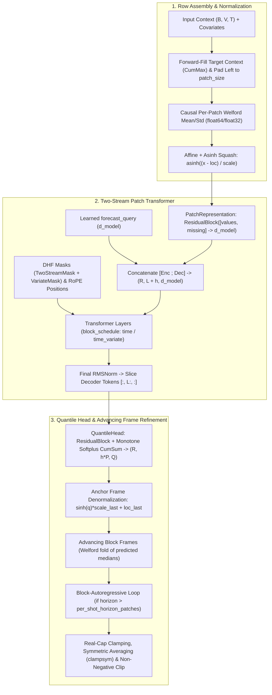

# Timestral: Time Series Foundation Models in GoMLX (`models/timestral`)

> [!NOTE]
> This document serves as both the architectural **Design Document** and the package **Documentation** for supporting Mistral AI's **Timestral** time series foundation models in GoMLX via `github.com/gomlx/go-huggingface/models/timestral`.

---

## 1. Overview & References

**Timestral** is Mistral AI's family of causal patch-based transformer foundation models for multivariate probabilistic time series forecasting, trained with **Decoupled Horizon Forecasting (DHF)** and monotone quantile heads.

* **Blog Post**: [Timestral by Mistral AI](https://mistral.ai/news/timestral)
* **Hugging Face Collection**: [`mistralai/timestral`](https://huggingface.co/collections/mistralai/timestral)
* **Reference Python Implementation**: [`github.com/mistralai/timestral`](https://github.com/mistralai/timestral) (Apache 2.0 License)
* **Related GoMLX ONNX Benchmark Discussion**: [`gomlx/onnx-gomlx#94`](https://github.com/gomlx/onnx-gomlx/pull/94)

### 1.1. Supported Checkpoints & Repository Agnosticism

While Mistral AI officially released four pretrained checkpoints on the Hugging Face Hub, the `models/timestral` package is **completely config-driven** (`config.json` + `model.safetensors`) and accepts any [`*hub.Repo`](../../hub) instance:

| Official Model | Hugging Face Repo ID | `d_model` | `num_heads` | `mlp_hidden_dim` | Layers (`block_schedule`) | Weights (FP32) |
| :--- | :--- | ---: | ---: | ---: | ---: | ---: |
| **Timestral-5M** | [`mistralai/Timestral-5M`](https://huggingface.co/mistralai/Timestral-5M) | 192 | 3 | 512 | 8 (`3×time, 1×time_variate` × 2) | ~21 MB |
| **Timestral-28M** | [`mistralai/Timestral-28M`](https://huggingface.co/mistralai/Timestral-28M) | 384 | 6 | 1024 | 12 (`3×time, 1×time_variate` × 3) | ~111 MB |
| **Timestral-123M** | [`mistralai/Timestral-123M`](https://huggingface.co/mistralai/Timestral-123M) | 640 | 10 | 1712 | 20 (`3×time, 1×time_variate` × 5) | ~490 MB |
| **Timestral-209M** | [`mistralai/Timestral-209M`](https://huggingface.co/mistralai/Timestral-209M) | 768 | 12 | 2048 | 24 (`3×time, 1×time_variate` × 6) | ~837 MB |
| **Custom / Fine-tuned** | Any `*hub.Repo` (Remote, `hub.NewLocal`, or `hub.NewEmbed`) | From `config.json` | From `config.json` | From `config.json` | From `config.json` | `.safetensors` |

Because `LoadModel(repo *hub.Repo)` reads `config.json` via `repo.ReadFile("config.json")` and streams weights via `safetensors.IterTensorsFromRepo(backend, repo)`, it transparently supports:
1. **Remote Hub repositories**: `hub.New("mistralai/Timestral-28M")` (or community fine-tunes / custom variants).
2. **Offline / Local directories**: `hub.NewLocal("/path/to/checkpoint")`.
3. **Embedded filesystems**: `hub.NewEmbed(embeddedFS, "timestral-5m")`.

---

## 2. Architecture Deep-Dive

Timestral forecasts multivariate time series by packing all variates and covariates across a batch into a 2D sequence of rows `(R, T)` where `R = B * V_all` (`B` = batch size, `V_all` = target variates + past covariates + known-future covariates) and `T` is a multiple of `patch_size` (typically `32`).



### 2.1. Key Mathematical Components

1. **Causal Per-Patch Welford Normalization (`scaler.go`)**:
   - At each time step $t$, causal running mean $\mu_t$ and sample standard deviation $s_t$ (with Bessel's correction $N - 1$, clamped to $\ge \text{minimum\_scale}$) are computed over observed values in $0 \dots t$:
     $$
     w_t = \mathbb{I}[\text{observed}_t], \quad W_t = \max\left(1, \sum_{i=0}^t w_i\right), \quad \mu_t = \frac{\sum_{i=0}^t w_i x_i}{W_t}
     $$
     $$
     M_{2,t} = \sum_{i=0}^t w_i (x_i - \mu_{i-1})(x_i - \mu_i), \quad s_t = \max\left(\text{minimum\_scale}, \sqrt{\frac{M_{2,t}}{\max(1, W_t - 1)}}\right)
     $$
   - Each patch of length $P$ (`patch_size = 32`) takes the causal $(\mu, s)$ at the **last step of that patch** and broadcasts them across all $P$ steps of the patch.
   - Observed values are normalized via $\text{asinh}((x - \mu) / s)$; unobserved values are set to $0$.
   - Known-future covariate rows use whole-row (non-causal) instance normalization (`instance_norm_stats`), and binary indicator rows ($\in \{0, 1\}$) skip the $\text{asinh}$ squash.

2. **Patch Representation (`layers.go`)**:
   - Each context patch concatenates normalized values $(R, N, P)$ and missing-value indicators $(R, N, P)$ into $(R, N, 2P)$ and projects to $D = \text{d\_model}$ via a `ResidualBlock`:
     $$
     \text{ResidualBlock}(x) = W_{\text{out}}(\text{SiLU}(W_{\text{hid}} x + b_{\text{hid}})) + b_{\text{out}} + (W_{\text{res}} x + b_{\text{res}})
     $$
   - Decoder tokens $x_{\text{dec}}$ of shape $(R, h, D)$ are broadcast from the learned parameter `representation.forecast_query` of shape $(D,)$.

3. **Alternating Time / Variate Transformer (`layers.go`, `masks.go`)**:
   - The `block_schedule` specifies the attention axes for each layer (`"time"`, `"variate"`, `"time_variate"`, `"variate_time"`).
   - **QKV Weight Packing**: `wQKV` projects $D \to 3D$. Critically, Timestral packs the output of `wQKV` as `(batch, seq, 3, head_dim, num_heads)` and permutes `(2, 0, 1, 4, 3)` to obtain $Q, K, V$ each of shape `(batch, seq, num_heads, head_dim)`.
   - **Partial Sin/Cos RoPE**: Only applied during **time attention**. The first `rope_dim = int(head_dim * rope_partial_factor)` dimensions are rotated using split-half rotary embeddings (`_rotate_half`), while the remaining dimensions have `inv_freq = 0` ($\cos = 1, \sin = 0$, identity). Positions are anchored per series at the group's first observed patch (`p - first_obs`).
   - **Two-Stream Split Attention**: When `split_context_horizon_attn` is true (default), time attention splits queries into:
     - Encoder queries `q[:, :L]` attending only to encoder keys `k[:, :L]` with causal + key-validity mask `(R, 1, L, L)`.
     - Decoder queries `q[:, L:]` attending to all keys `k[:, :L+h]` with mask `(R, 1, h, L+h)`.
     This avoids computing the zeroed-out context-to-horizon quadrant $(L \times h)$.
   - **SDPA Sigmoid Gate**: Before the output projection `wO`, the SDPA output is gated by $\text{out} \odot \sigma(W_{\text{gate}} x)$.
   - **Variate Attention**: Permutes $(R, N, D) \to (N, R, D)$ and runs multi-head attention across the variates of each series, respecting the exogenous covariate firewall (covariates never read targets; known-future covariates never read causal rows).
   - **FusedSwiGLU MLP**: Pre-RMSNorm followed by `w12` ($D \to 2 H_{\text{mlp}}$), split in half along the last axis into `gate` and `up`:
     $$
     \text{MLP}(x) = W_3(\text{gate} \odot \text{SiLU}(\text{up}))
     $$

4. **Monotone Quantile Head (`model.go`)**:
   - Applies a bias-free `ResidualBlock` ($D \to 4D \to P \times Q$), reshapes to $(R, h, P, Q)$, and constructs non-crossing quantiles around the unconstrained median index $m$ ($\tau_m = 0.5$):
     $$
     \Delta_i = \text{quantile\_width\_factor} \cdot |\tau_i - \tau_{\text{inner}(i)}| \cdot \text{softplus}(\text{raw}_i)
     $$
     $$
     q_i = \begin{cases}
     \text{raw}_m - \sum_{j=i}^{m-1} \Delta_j & \text{if } i < m \\
     \text{raw}_m & \text{if } i = m \\
     \text{raw}_m + \sum_{j=m+1}^{i} \Delta_j & \text{if } i > m
     \end{cases}
     $$

5. **Advancing Refine Frame & Clampsym (`forecaster.go`, `scaler.go`)**:
   - Within a decoded block of $h$ patches, patch $0$ uses the anchor frame $(\mu_{\text{last}}, s_{\text{last}})$ of the last context patch. Each subsequent patch $j \in \{1 \dots h-1\}$ updates the Welford state with the denormalized predicted medians of patches $0 \dots j-1$ (`advancing_block_frames`), re-scaling patch $j$'s normalized quantiles into its advancing frame.
   - **Clampsym**:
     - *Symmetric Averaging*: Runs the raw forecast on `context` and `-context` (negating covariates as well), reflects the negated forecast's quantiles (`-mirrored` reversed along the $Q$ axis), and averages: $0.5 \cdot (Q(x) - \text{flip}(Q(-x)))$. When batching `context` and `-context` into a single batch of size $2B$, both passes execute in a **single** graph invocation!
     - *Non-Negative Clipping*: Clamps quantile predictions to $\ge 0$ for any series whose observed context is entirely $\ge 0$.

---

## 3. Prerequisite: `CumMax` in `gomlx/compute` & `gomlx/gomlx/core/graph`

Timestral relies on cumulative maximum (`cummax(dim=-1)`) in two places:
1. **`ffill_with_mask`**: Forward-filling unobserved time steps by taking the running maximum of observed step indices (`idx.cummax(dim=-1).values`) before `Gather`.
2. **`compute_enc_key_validity` / `_encoding_target`**: Determining whether a series has started at or before each patch (`obs_per_patch.cummax(dim=-1).values`).

Rather than emulating `cummax` with a $\lceil \log_2 T \rceil$ Hillis-Steele doubling loop (which creates 14+ intermediate `Slice`/`Concatenate`/`Max` graph nodes for a 12,096-step context), we will define `CumMax` as a first-class operation alongside `CumSum`:

### 3.1. `gomlx/compute` Changes
- **`optype.go` & `ops.go`**:
  - Add `OpTypeCumMax` next to `OpTypeCumSum` and regenerate enumer (`go generate`).
  - Add `CumMax` to `StandardOps` using the existing `CumSumOptions` (with an alias `type CumMaxOptions = CumSumOptions` if helpful):
    ```go
    // CumMax returns the cumulative maximum of the elements along the given axis.
    // For Exclusive=true, the identity element is LowestValueForDType(dtype) (e.g. -Inf for floats, MinInt for signed ints, 0 for uints).
    CumMax(operand Value, axis int, options CumSumOptions) (Value, error)
    ```
- **`shapeinference/shapeinference.go`**:
  - Add `CumMax(operand shapes.Shape, axis int) (shapes.Shape, error)` (identical shape rules to `CumSum`).
- **Go Backend (`internal/gobackend/ops/cummax.go` & `capabilities.go`)**:
  - Enable `compute.OpTypeCumMax: true` in `capabilities.go`.
  - Implement `CumMax` in `internal/gobackend/ops/cummax.go` (mirroring `cumsum.go`), supporting `ints, uints, floats` and `half` (`float16`, `bfloat16`) in $O(N)$ single-pass loops (and parallelizing across `outerSize` when large).
- **Tests (`support/backendtest/special.go`)**:
  - Add `TestCumMax` next to `TestCumSum` covering 1D/2D/3D, `Exclusive`, `Reverse`, `Exclusive+Reverse`, and half precision.

### 3.2. `gomlx/gomlx/core/graph` Changes
- **`gen_compute_ops.go` & `ops_util.go`**:
  - Run code generation in `core/graph` to generate `NodeTypeCumMax` and `backendCumMax`.
  - Expose `CumMax(x *Node, axis int, options ...*CumSumOptions) *Node` in `ops_util.go` right next to `CumSum`:
    ```go
    // CumMax returns the cumulative maximum along the given axis.
    // It uses the backend's native CumMax if available, and falls back to a decomposed
    // implementation (using MaxPool) otherwise.
    func CumMax(x *Node, axis int, options ...*CumSumOptions) *Node
    ```
  - **Fallback (`cumMaxDecomposed`)**: Mirroring `cumSumDecomposed` (which uses `SumPool`), `cumMaxDecomposed` uses `MaxPool(cur).FullShape().WindowPerAxis(windowSizes...).PaddingPerDim(paddings).Strides(1).Done()`, padding with `Scalar(g, cur.DType(), cur.DType().LowestValue())` when `options.Exclusive` is true.
  - **Autodiff (`rev_autodiff.go`)**: Register `cumMaxVJP` (or leave gradient for future if not needed, or implement using `SelectAndScatterMax` / indicator mask where `output == input`).

---

## 4. Package File Layout & Responsibilities

The package will live under [`models/timestral/`](file:///home/janpf/Projects/gomlx/go-huggingface/models/timestral) and follow GoMLX's idiomatic **Builder Pattern** (like `gomlx/ml/layers/fnn`, `norm.RMSNorm`, and `zoo/transformer`):

```
models/timestral/
├── README.md          # Package documentation and architectural design (this file)
├── config.go          # Config struct, LayerKind / AttentionGate enums, validation, JSON loading
├── model.go           # Model struct, LoadModel(*hub.Repo), LoadStore, GraphBuilder, safetensors weight mapping
├── layers.go          # GoMLX graph layers: ResidualBlock, FusedSwiGLU, SinCosRoPE, Attention, TransformerBlock
├── masks.go           # DHF time & variate mask builders and RoPE position builders in GoMLX graph
├── scaler.go          # Causal Welford statistics, asinh/sinh normalization, advancing block frames
├── forecaster.go      # High-level Forecaster & ForecastCall builders, ForecastOutput, block-AR loop, clampsym
├── covariates.go      # Smoothed mean-target encoding for categorical covariates
└── timestral_test.go  # Unit tests (synthetic tiny model + golden comparison against PyTorch)
```

---

## 5. API Design (Builder Pattern)

Following GoMLX conventions (such as [`fnn.New(...).Done()`](file:///home/janpf/Projects/gomlx/gomlx/ml/layers/fnn/fnn.go)), configuration is performed via chainable builder methods rather than options structs or functional option closures.

### 5.1. Model & Configuration Loading (`config.go`, `model.go`)

```go
package timestral

import (
	"github.com/gomlx/compute"
	"github.com/gomlx/go-huggingface/hub"
	"github.com/gomlx/gomlx/ml/model"
)

// Well-known Hugging Face Hub repository IDs for Mistral AI's Timestral checkpoints.
const (
	RepoTimestral5M   = "mistralai/Timestral-5M"
	RepoTimestral28M  = "mistralai/Timestral-28M"
	RepoTimestral123M = "mistralai/Timestral-123M"
	RepoTimestral209M = "mistralai/Timestral-209M"
)

// LayerKind specifies the sequence of attention sublayers in a TransformerBlock.
type LayerKind string

const (
	LayerTime        LayerKind = "time"
	LayerVariate     LayerKind = "variate"
	LayerTimeVariate LayerKind = "time_variate"
	LayerVariateTime LayerKind = "variate_time"
)

// Config holds the inference configuration parsed from config.json.
type Config struct {
	PatchSize               int         `json:"patch_size"`
	DModel                  int         `json:"d_model"`
	NumHeads                int         `json:"num_heads"`
	MLPHiddenDim            int         `json:"mlp_hidden_dim"`
	BlockSchedule           []LayerKind `json:"block_schedule"`
	QuantileKnots           []float64   `json:"quantile_knots"`
	BlockSize               int         `json:"block_size"`
	ContextLength           int         `json:"context_length"`
	RoPETheta               float64     `json:"rope_theta"`
	RoPEPartialFactor       float64     `json:"rope_partial_factor"`
	NormEps                 float64     `json:"norm_eps"`
	AttnBias                bool        `json:"attn_bias"`
	MLPBias                 bool        `json:"mlp_bias"`
	TimeAttnGate            string      `json:"time_attn_gate"`
	VariateAttnGate         string      `json:"variate_attn_gate"`
	MinimumScale            float64     `json:"minimum_scale"`
	UseAsinh                bool        `json:"use_asinh"`
	StabilizeWithGlobal     bool        `json:"stabilize_with_global"`
	CovariateEnabled        bool        `json:"covariate_enabled"`
	SplitContextHorizonAttn bool        `json:"split_context_horizon_attn"`
	AttendMissingPatches    bool        `json:"attend_missing_patches"`
	QuantileWidthFactor     float64     `json:"quantile_width_factor"`
}

// Helper methods on Config:
func (c *Config) HeadDim() int                 // DModel / NumHeads
func (c *Config) RoPEDim() int                 // int(float64(HeadDim()) * RoPEPartialFactor)
func (c *Config) NumQuantiles() int            // len(QuantileKnots)
func (c *Config) MedianIndex() int             // index of 0.5 in QuantileKnots
func (c *Config) SupportsKnownCovariates() bool
func (c *Config) Validate() error

// Model holds the loaded configuration and reference to the Hugging Face repository.
type Model struct {
	Repo   *hub.Repo
	Config *Config
}

// LoadModel reads and validates config.json from repo (supports remote, local, and embedded repos).
func LoadModel(repo *hub.Repo) (*Model, error)

// LoadStore streams model.safetensors from m.Repo into store, transposing 2D Linear weights
// to GoMLX's [in_features, out_features] convention and organizing variables into scopes.
func (m *Model) LoadStore(backend compute.Backend, store *model.Store) error

// Description returns a human-readable summary of the model architecture and parameter count.
func (m *Model) Description() string
```

### 5.2. Low-Level GoMLX Graph Builder API (`model.go`, `layers.go`, `scaler.go`)

For users building GoMLX computation graphs directly (such as `examples/timestral` or custom training/inference pipelines), `m.BuildGraph(scope, context, horizonSteps)` returns a chainable `*GraphBuilder` terminated by `.Done()` (just like `fnn.New(scope, x, dims...).Done()`):

```go
// GraphBuilder configures and builds a Timestral forecast computation graph.
// Created via Model.BuildGraph(scope, context, horizonSteps).
type GraphBuilder struct {
	// Unexported fields: model, scope, context, observationMask, horizonSteps,
	// pastCovariates, knownCovariates, quantileRealCapK, refineBlock,
	// symmetricAveraging, clipNonNegative, maxContext, perShotHorizonPatches
}

// BuildGraph starts building a Timestral forecast graph for the given context and horizonSteps.
//
//   - scope: GoMLX model scope containing the loaded Timestral variables.
//   - context: float32 *graph.Node shaped [B, T] (univariate) or [B, V, T] (multivariate).
//     NaN entries are automatically detected as missing values.
//   - horizonSteps: number of future time steps H to forecast (H >= 1).
//
// Example usage (matching export.py's RawForecast for benchmarking):
//
//	quantiles := tmModel.BuildGraph(scope, ctxNode, 864).Done()
//
// Example usage with full clampsym & covariates inside the graph:
//
//	quantiles := tmModel.BuildGraph(scope, ctxNode, 96).
//		WithObservationMask(obsMaskNode).
//		WithPastCovariates(pastCovNode).
//		WithKnownCovariates(knownCovNode).
//		SymmetricAveraging(true).
//		ClipNonNegative(true).
//		Done()
func (m *Model) BuildGraph(scope *model.Scope, context *graph.Node, horizonSteps int) *GraphBuilder

// Chainable builder methods on *GraphBuilder:

// WithObservationMask provides an explicit boolean observation mask shaped like context (false = missing).
// Combined with IsFinite(context).
func (b *GraphBuilder) WithObservationMask(mask *graph.Node) *GraphBuilder

// WithPastCovariates adds past-only numeric covariates shaped [B, C_past, T].
func (b *GraphBuilder) WithPastCovariates(past *graph.Node) *GraphBuilder

// WithKnownCovariates adds known-future numeric covariates shaped [B, C_known, T + horizonSteps].
func (b *GraphBuilder) WithKnownCovariates(known *graph.Node) *GraphBuilder

// MaxContext sets the maximum context length in time steps (defaults to Config.ContextLength = 32768).
func (b *GraphBuilder) MaxContext(steps int) *GraphBuilder

// PerShotHorizonPatches sets the maximum patches decoded per autoregressive block (defaults to min(32, Config.BlockSize)).
func (b *GraphBuilder) PerShotHorizonPatches(patches int) *GraphBuilder

// QuantileRealCapK sets the real-space quantile clamp factor k (defaults to 1e4; 0 disables).
func (b *GraphBuilder) QuantileRealCapK(k float64) *GraphBuilder

// SymmetricAveraging enables/disables forecasting both context and -context and averaging
// with the reflected quantiles inside the graph (defaults to false in BuildGraph so raw single-pass
// execution is the default, or true if enabled).
func (b *GraphBuilder) SymmetricAveraging(enabled bool) *GraphBuilder

// ClipNonNegative enables/disables clamping quantiles at 0 for series with non-negative context
// (defaults to false in BuildGraph).
func (b *GraphBuilder) ClipNonNegative(enabled bool) *GraphBuilder

// Done constructs the GoMLX computation graph and returns the quantiles *graph.Node
// shaped [B, H, Q] (if context was [B, T]) or [B, V, H, Q] (if context was [B, V, T]).
func (b *GraphBuilder) Done() *graph.Node
```

For lower-level access to a single pre-padded DHF block (corresponding to Python's `TimestralModel.predict_block`), we also expose a builder:

```go
// BlockBuilder configures a single-block DHF forward pass over packed (R, T) rows.
type BlockBuilder struct {
	// Unexported fields
}

// NewBlockBuilder starts configuring a single-block DHF prediction over packed rows:
//   - inputs: float32 [R, T] where T is a multiple of PatchSize.
//   - observed: bool [R, T] observation mask.
//   - horizonPatches: number of patches h to decode in this block.
func (m *Model) NewBlockBuilder(scope *model.Scope, inputs, observed *graph.Node, horizonPatches int) *BlockBuilder

func (b *BlockBuilder) WithGroupIDs(groupIDs *graph.Node) *BlockBuilder
func (b *BlockBuilder) WithCovariates(roleIDs, knownFuture, knownFutureMask *graph.Node) *BlockBuilder
func (b *BlockBuilder) RefineAdvancingFrame(enabled bool) *BlockBuilder // Default: false in raw predict_block, true in forecaster
func (b *BlockBuilder) Done() *graph.Node                                // Returns float32 [R, h * PatchSize, Q]
```

### 5.3. High-Level Go `Forecaster` API (`forecaster.go`)

For end-to-end Go applications, `Forecaster` manages the `model.Store` and compiled `model.Exec` instances, and uses the **Builder Pattern** both for configuring the `Forecaster` itself and for configuring individual forecast calls:

```go
// Forecaster wraps a Timestral Model, its GoMLX Store, and compiled executors.
type Forecaster struct {
	// Unexported fields: backend, model, store, maxContext, perShotHorizonPatches,
	// quantileRealCapK, extremeValueThreshold, variableAsConst, execCache
}

// NewForecaster creates a Forecaster for the given backend and loaded Model, and loads
// the model weights from modelObj.Repo into an internal GoMLX model.Store.
//
// Hyperparameters can be customized via chainable builder methods on the returned *Forecaster:
//
//	fc, err := timestral.NewForecaster(backend, tmModel)
//	if err != nil { ... }
//	fc.MaxContext(16384).QuantileRealCapK(1e4)
func NewForecaster(backend compute.Backend, modelObj *Model) (*Forecaster, error)

// Chainable configuration methods on *Forecaster:
func (f *Forecaster) MaxContext(steps int) *Forecaster               // Default: Config.ContextLength (32768)
func (f *Forecaster) PerShotHorizonPatches(patches int) *Forecaster  // Default: min(32, Config.BlockSize)
func (f *Forecaster) QuantileRealCapK(k float64) *Forecaster         // Default: 1e4 (0 disables)
func (f *Forecaster) ExtremeValueThreshold(t float64) *Forecaster    // Default: 1e30

// ForecastCall is a builder for a single forecasting request, created by Forecaster.Forecast(...).
type ForecastCall struct {
	// Unexported fields
}

// Forecast starts building a forecast call for predictionLength future steps after context.
// context can be a *tensors.Tensor, []float32 (shape [T]), [][]float32 (shape [B, T]),
// or [][][]float32 (shape [B, V, T]). NaN marks missing values.
//
// By default, SymmetricAveraging(true) and ClipNonNegative(true) are enabled (matching Python's TimestralForecaster.forecast).
//
// Example:
//
//	res, err := fc.Forecast(context, 96).
//		WithPastCovariates(past).
//		WithKnownCovariates(known).
//		SymmetricAveraging(true).
//		ClipNonNegative(true).
//		Done()
func (f *Forecaster) Forecast(context any, predictionLength int) *ForecastCall

// Chainable builder methods on *ForecastCall:
func (c *ForecastCall) WithObservationMask(mask any) *ForecastCall
func (c *ForecastCall) WithPastCovariates(past any) *ForecastCall
func (c *ForecastCall) WithKnownCovariates(known any) *ForecastCall
func (c *ForecastCall) WithCategoricalPastCovariates(codes any) *ForecastCall
func (c *ForecastCall) WithCategoricalKnownCovariates(codes any) *ForecastCall
func (c *ForecastCall) SymmetricAveraging(enabled bool) *ForecastCall // Default: true
func (c *ForecastCall) ClipNonNegative(enabled bool) *ForecastCall    // Default: true

// Done executes the forecast and returns the *ForecastResult.
func (c *ForecastCall) Done() (*ForecastResult, error)

// ForecastResult holds the output of a Forecast call, mirroring Python's timestral.Forecast.
type ForecastResult struct {
	// Quantiles has shape [B, V, PredictionLength, Q] (float32).
	Quantiles      *tensors.Tensor
	QuantileLevels []float64
	medianIndex    int
}

// Median extracts the median (0.5 quantile) forecast as a tensor of shape [B, V, PredictionLength].
func (r *ForecastResult) Median() (*tensors.Tensor, error)

// Quantile extracts the forecast at the given probability level (e.g. 0.1, 0.9) as [B, V, PredictionLength].
func (r *ForecastResult) Quantile(level float64) (*tensors.Tensor, error)

// Close finalizes the underlying Quantiles tensor.
func (r *ForecastResult) Close()
```

---

## 6. Weight Mapping & SafeTensors Loading (`model.go`)

Timestral's `model.safetensors` stores weights in standard PyTorch `nn.Linear` layout `[out_features, in_features]`, whereas GoMLX's `layers.Dense` / `DotGeneral` expects `[in_features, out_features]`.

### 6.1. Complete Tensor Inventory & Scope Mapping

| SafeTensors Tensor Name | PyTorch Shape (e.g. 28M) | Action on Load | GoMLX Scope Path & Variable Name | GoMLX Shape |
| :--- | :--- | :--- | :--- | :--- |
| `representation.forecast_query` | `[384]` | Direct | `/representation/forecast_query` | `[384]` |
| `representation.patch_proj.hidden_layer.weight` | `[1536, 64]` | Transpose 2D | `/representation/patch_proj/hidden_layer/dense/weights` | `[64, 1536]` |
| `representation.patch_proj.hidden_layer.bias` | `[1536]` | Direct | `/representation/patch_proj/hidden_layer/dense/biases` | `[1536]` |
| `representation.patch_proj.output_layer.weight` | `[384, 1536]` | Transpose 2D | `/representation/patch_proj/output_layer/dense/weights` | `[1536, 384]` |
| `representation.patch_proj.output_layer.bias` | `[384]` | Direct | `/representation/patch_proj/output_layer/dense/biases` | `[384]` |
| `representation.patch_proj.residual_layer.weight` | `[384, 64]` | Transpose 2D | `/representation/patch_proj/residual_layer/dense/weights` | `[64, 384]` |
| `representation.patch_proj.residual_layer.bias` | `[384]` | Direct | `/representation/patch_proj/residual_layer/dense/biases` | `[384]` |
| `transformer.layers.{L}.attn_norms.{A}.scale` | `[384]` | Direct | `/transformer/layers/{L}/attn_norms/{A}/rms_norm/scale` | `[384]` |
| `transformer.layers.{L}.attns.{A}.wQKV.weight` | `[1152, 384]` | Transpose 2D | `/transformer/layers/{L}/attns/{A}/wQKV/dense/weights` | `[384, 1152]` |
| `transformer.layers.{L}.attns.{A}.wQKV.bias` *(if `attn_bias`)* | `[1152]` | Direct | `/transformer/layers/{L}/attns/{A}/wQKV/dense/biases` | `[1152]` |
| `transformer.layers.{L}.attns.{A}._gate.weight` | `[384, 384]` | Transpose 2D | `/transformer/layers/{L}/attns/{A}/_gate/dense/weights` | `[384, 384]` |
| `transformer.layers.{L}.attns.{A}.wO.weight` | `[384, 384]` | Transpose 2D | `/transformer/layers/{L}/attns/{A}/wO/dense/weights` | `[384, 384]` |
| `transformer.layers.{L}.mlp_norm.scale` | `[384]` | Direct | `/transformer/layers/{L}/mlp_norm/rms_norm/scale` | `[384]` |
| `transformer.layers.{L}.mlp.w12.weight` | `[2048, 384]` | Transpose 2D | `/transformer/layers/{L}/mlp/w12/dense/weights` | `[384, 2048]` |
| `transformer.layers.{L}.mlp.w3.weight` | `[384, 1024]` | Transpose 2D | `/transformer/layers/{L}/mlp/w3/dense/weights` | `[1024, 384]` |
| `transformer.out_norm.scale` | `[384]` | Direct | `/transformer/layers/out_norm/rms_norm/scale` | `[384]` |
| `head.projection.hidden_layer.weight` | `[1536, 384]` | Transpose 2D | `/head/projection/hidden_layer/dense/weights` | `[384, 1536]` |
| `head.projection.output_layer.weight` | `[672, 1536]` | Transpose 2D | `/head/projection/output_layer/dense/weights` | `[1536, 672]` |
| `head.projection.residual_layer.weight` | `[672, 384]` | Transpose 2D | `/head/projection/residual_layer/dense/weights` | `[384, 672]` |

> [!TIP]
> **Eliminating the 5D `wQKV` Transpose at Weight-Load Time**:
> In PyTorch (`timestral/layers.py`), `wQKV` has output dimension `3 * head_dim * num_heads` packed as `[3, head_dim, num_heads]`, requiring a 5D `permute(2, 0, 1, 4, 3)` on `[batch, seq, 3, head_dim, num_heads]` at every attention layer.
> During `LoadStore`, we can permute `wQKV`'s output axes once from `[3, head_dim, num_heads]` to `[3, num_heads, head_dim]` (while transposing `[out, in] -> [in, out]`). Then at runtime, `wQKV(x)` directly has layout `[batch, seq, 3, num_heads, head_dim]`, avoiding the 5D transpose completely!

---

## 7. GoMLX Graph Implementation Details & Subtleties

When translating the PyTorch reference code (`/home/janpf/src/timestral/src/timestral/`) into GoMLX graph operations, several subtle details must be handled carefully to maintain `< 5e-5` numerical parity with PyTorch:

### 7.1. Forward-Fill (`ffill_with_mask`) and Key Validity (`compute_enc_key_validity`) using `graph.CumMax`
With `graph.CumMax` added (Section 3):
- **`ffillWithMask(inputs, mask)`**:
  ```go
  idx := Iota(g, shapes.Make(dtypes.Int32, inputs.Shape().Dimensions...), -1)
  idx = Where(mask, idx, ZerosLike(idx))
  idx = CumMax(idx, -1)
  // Gather along the last axis using idx:
  gathered := GatherLastAxis(inputs, idx)
  return Where(IsFinite(gathered), gathered, ZerosLike(gathered))
  ```
- **`computeEncKeyValidity(obsPerPatch, attendMissing)`**:
  ```go
  if !attendMissing {
      return obsPerPatch
  }
  started := GreaterThan(CumMax(ConvertDType(obsPerPatch, dtypes.Int32), -1), ScalarZero(g, dtypes.Int32))
  return LogicalOr(obsPerPatch, started)
  ```

### 7.2. Float64 vs Float32 in Welford Causal Statistics (`scaler.go`)
- In Python's `compute_causal_statistics` and `advancing_block_frames`, Welford running sums (`cum_w`, `cum_x`, `m2`) are accumulated in `float64` (`dtypes.Float64`) to prevent catastrophic cancellation when a time series has a large constant offset (e.g. $10^6 \pm 1$) over $32,768$ steps, and then cast back to `dtypes.Float32`.
- All GoMLX backends (`go` and `xla`) support `dtypes.Float64` for `ConvertDType`, `CumSum`, `Add`, `Sub`, `Mul`, `Div`, `Sqrt`, `Max`, `Min`, and `Where`.
- In `advancing_block_frames`, the context patch moments are reduced per patch (`[R, L, P] -> [R, L]`), combined via `cumulativeWelford` ($\lceil \log_2 L \rceil$ steps over patch count $L$, e.g. 9 steps for $L = 378$), and then unrolled `for h := range nPred` (at most 32 iterations) to fold each predicted median patch into the Welford state.

### 7.3. Partial RoPE with Per-Row Anchored Positions (`layers.go`)
- In Timestral, `positions` has shape `[R, N]` where each row $r$ can have a different `first_obs` offset if series start at different patches (`positions = arange(N) - first_obs[:, None]`).
- Only the first `rope_dim = int(head_dim * rope_partial_factor)` dimensions of each head are rotated (`rope_partial_factor = 0.5`, so 32 out of 64 dims in 28M/123M).
- We implement `SinCosRoPE` directly matching `timestral/layers.py`:
  1. Precompute `invFreq` of shape `[head_dim / 2]` where `invFreq[i] = 1.0 / pow(base, float(2*i)/float(rope_dim))` for $i < \text{rope\_dim}/2$, and $0.0$ for $i \ge \text{rope\_dim}/2$.
  2. Multiply `positions` `[R, N, 1]` by `invFreq` `[1, 1, head_dim/2]` $\to$ `freqs` `[R, N, head_dim/2]`.
  3. Concatenate `[freqs, freqs]` along axis `-1` $\to$ `emb` `[R, N, head_dim]`, and compute `cos = Cos(emb)`, `sin = Sin(emb)`.
  4. Expand axis `2` (`[R, N, 1, head_dim]`) to broadcast across `num_heads` and apply:
     $$
     \text{rot}(x) = x \odot \cos + \text{rotate\_half}(x) \odot \sin
     $$

### 7.4. Two-Stream Time Attention & Variate Attention (`layers.go`)
- Using `attention.Core(q, k, v, attention.LayoutBHSD, attention.CoreOptions{AttentionMask: mask})`:
  - `attention.Core` accepts boolean `AttentionMask` (`true` = attend, `false` = mask out) broadcastable to `[batch, numHeads, q_seq, kv_seq]`.
  - When `SplitContextHorizonAttn` is enabled on time attention:
    - Context pass: `qEnc` (`[:, :, :encLen, :]`) attends to `kEnc`, `vEnc` with mask `mask[:, :, :encLen, :encLen]`.
    - Horizon pass: `qDec` (`[:, :, encLen:, :]`) attends to full `k`, `v` with mask `mask[:, :, encLen:, :]`.
    - Concatenate `[outEnc, outDec]` along the sequence axis.

---

## 8. Example, Benchmark & Test Suite (`./examples/timestral`)

To validate accuracy against PyTorch and benchmark native GoMLX execution against the ONNX-converted model in `../benchmarks/timestral`, we will create `./examples/timestral/`:

```
examples/timestral/
├── README.md           # Usage instructions & benchmark comparison table
├── main.go             # CLI benchmark & forecasting tool (drop-in counterpart to ../benchmarks/timestral)
└── timestral_test.go   # Integration test verifying Timestral-28M against reference outputs
```

### 8.1. How `examples/timestral/main.go` Works

`examples/timestral/main.go` mimics `../benchmarks/timestral/main.go` so that performance and numerical accuracy can be compared directly, while loading the model from Hugging Face Hub (or local cache) via `hub.New` and `models/timestral`:

1. **Flags**:
   - `-model`: Hugging Face repo ID or local path (default: `"mistralai/Timestral-28M"`, can also pass `"mistralai/Timestral-123M"`, `"mistralai/Timestral-5M"`, `"mistralai/Timestral-209M"`, or a local directory).
   - `-compare`: Optional path to a `.f32` PyTorch reference results file (such as `./examples/timestral/model-28m_test_results.f32` or `./examples/timestral/model-123m_test_results.f32`) to compute `Max Abs Diff vs PyTorch`.
   - `-context-steps`: Context length (default: `12096`, corresponding to 42 days of 5-minute steps with a 200-step `NaN` gap).
   - `-horizon-steps`: Prediction horizon length (default: `864`, corresponding to 72 hours of 5-minute steps).
   - `-backend`: GoMLX backend config (default: `"go"`, or `"xla:cpu"`, `"xla:cuda"`, etc.).
   - `-runs`: Number of timed runs after the warm-up run (default: `5`).
   - `-obs`: Optional observation label for the Markdown table rows.

2. **Execution Flow using the Builder API**:
   ```go
   repo := hub.New(modelID)
   tmModel := must1(timestral.LoadModel(repo))
   store := mlmodel.NewStore().WithVariableAsConst(true)
   must(tmModel.LoadStore(backend, store))
   exec := must1(mlmodel.NewExec(backend, store, func(scope *mlmodel.Scope, x *graph.Node) *graph.Node {
       return tmModel.BuildGraph(scope, x, horizonSteps).Done()
   }))
   must1(exec.Compile(shapes.Make(dtypes.Float32, batch, contextSteps)))
   store.Finalize()
   debug.FreeOSMemory()
   ```
   It then runs 1 warm-up + `N` timed iterations, measuring wall time, CPU time (`syscall.Getrusage`), average CPU cores (`CPU / Wall`), `Max Abs Diff vs PyTorch`, and `Max RSS (GB)`, printing the exact same Markdown table format:

```markdown
| Obs | Model | Run | Wall | CPU Time | Cores | Max Abs Diff vs PyTorch | Max RSS |
| --- | --- | :--- | ---: | ---: | ---: | ---: | ---: |
```

---

## 9. Implementation Plan

1. **Step 1 — Add `CumMax` to `gomlx/compute` and `gomlx/gomlx/core/graph`**:
   - Add `OpTypeCumMax` and `StandardOps.CumMax(operand, axis, options)` in `gomlx/compute`, implement `internal/gobackend/ops/cummax.go`, regenerate enumer/registrations, and add backend tests in `support/backendtest/special.go`.
   - Regenerate `gen_compute_ops.go` in `gomlx/gomlx/core/graph`, add `graph.CumMax` with `cumMaxDecomposed` fallback (via `MaxPool`) in `ops_util.go`, and add unit tests in `ops_util_test.go`.
2. **Step 2 — Core Configuration & Weight Loading (`models/timestral/config.go`, `model.go`)**:
   - Implement `Config`, `LoadConfig`, validation rules, and helper properties (`HeadDim`, `RoPEDim`, `MedianIndex`, `SupportsKnownCovariates`).
   - Implement `LoadModel(repo *hub.Repo)` and `Model.LoadStore(backend, store)` using `safetensors.IterTensorsFromRepo`, handling 2D weight transpositions and `wQKV` layout permutation.
3. **Step 3 — Normalization & Advancing Block Frames (`models/timestral/scaler.go`)**:
   - Implement `ComputeCausalStatistics`, `CausalPatchLocScale`, `ApplyAffineAsinhMasked`, `InvertAffineAsinh`, `ClampNonFinite`, `DenormalizeQuantiles`, `AdvancingBlockFrames`, and `InstanceNormStats` as GoMLX graph functions.
4. **Step 4 — DHF Masks & Positions (`models/timestral/masks.go`)**:
   - Implement `ComputeEncKeyValidity` (using `graph.CumMax`), `EncCausalMask`, `BuildForecastTimeMask`, `BuildForecastPositions`, `BuildTwoStreamTimeMask`, `BuildTwoStreamVariateMask`, and `GroupFirstObservedPatch`.
5. **Step 5 — Transformer, Head Layers & `GraphBuilder` (`models/timestral/layers.go`, `model.go`)**:
   - Implement `RMSNorm`, `ResidualBlock`, `FusedSwiGLU`, `SinCosRoPE`, `Attention` (with `TwoStreamMask` split attention and `sdpa_sigmoid` gate), `TransformerBlock`, `PatchRepresentation`, `QuantileHead`, `BlockBuilder`, and `GraphBuilder`.
6. **Step 6 — High-Level `Forecaster` & `ForecastCall` Builders (`models/timestral/forecaster.go`, `covariates.go`)**:
   - Implement `TargetEncode` in pure Go (`float64` accumulation, matching `covariate_encoding.py`).
   - Implement `Forecaster` and `ForecastCall` builders, block-autoregressive loop (`_block_ar_decode`), and clampsym (`SymmetricAveraging` and `ClipNonNegative`).
7. **Step 7 — Tests & Benchmark CLI (`models/timestral/timestral_test.go`, `examples/timestral/`)**:
   - Add unit tests in `models/timestral/timestral_test.go` covering config validation, synthetic tiny model shapes/monotonicity, symmetric averaging oddness, and categorical target encoding.
   - Implement `examples/timestral/main.go` and `examples/timestral/timestral_test.go`, and verify numerical parity (`Max Abs Diff ~ 1e-5`) and performance on `Timestral-28M` and `Timestral-123M`.
   - Record changes in `docs/CHANGELOG.md` across `compute`, `gomlx`, and `go-huggingface`.
